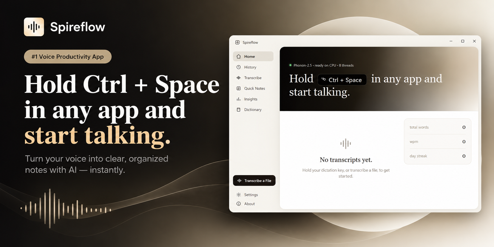

<h1 align="center">Spireflow</h1>

<p align="center"><strong>Hold a key. Speak. Your words appear in any app.</strong></p>

<p align="center">Local, private dictation for Windows and macOS.<br />
No cloud, no account, no audio leaving your machine.</p>

<p align="center">
  <a href="https://github.com/akshaynstack/spireflow/actions/workflows/ci.yml"></a>
  <a href="LICENSE"></a>
  <a href="https://www.fermionresearch.com/models/phonon-2-5/"></a>
  <a href="#requirements"></a>
  <a href="#privacy"></a>
</p>

<p align="center">
  <a href="assets/spireflow_preview.png">
    
  </a>
</p>

<p align="center"><sub>Spireflow on Windows. The same UI runs on macOS.</sub></p>

---

## Why Spireflow

| | | |
| :--: | :--: | :--: |
| **⚡ Hold to talk** | **🔒 Fully offline** | **🌍 25 languages** |
| Hold `Ctrl + Space` anywhere, speak, release. The text is pasted into whichever app has focus — editor, browser, chat, terminal. | Phonon-2.5 runs on your CPU. No API keys, no uploads, no accounts. Your voice never leaves the machine. | The multilingual model covers 25 European languages and detects the language automatically. The English model is the default. |
| **📊 Speaking stats** | **📝 Dictionary** | **📦 One installer** |
| Every transcript is saved locally with duration, word count and words per minute, plus daily streaks. | Teach the model names, jargon and acronyms with up to 25 hotwords. They bias the decoder without changing the model. | The installer bundles the Python runtime, the model weights and FFmpeg. End users need no Python and no downloads. |

---

## Quick start

### Requirements

- Windows 10/11 or macOS (Apple silicon or Intel)
- Node.js 18+ (built with Node 24)
- Python 3.10–3.14 (built with 3.14)

### Run from source

```bash
git clone https://github.com/akshaynstack/spireflow.git
cd spireflow

npm install
npm run setup:py      # creates server/.venv and installs fermion-research
npm run dev           # Electron + React with hot reload
```

The model (~156 MB) downloads on the **first launch** and is cached at
`~/.cache/fermion/`. The hero banner shows **Loading model…** and then
**Phonon-2.5 English · ready on CPU · N threads**.

> **Electron did not install?** Run `node node_modules/electron/install.js` once,
> then `npm run dev` again.

---

## The model: Phonon-2.5

[Phonon-2.5](https://www.fermionresearch.com/models/phonon-2-5/) is an open
speech-recognition model from [Fermion Research](https://fermionresearch.com).
It is 156 MB, runs on a laptop CPU, and is derived from NVIDIA's Parakeet TDT
0.6B v3.

| | |
| --- | --- |
| **Model ids** | `phonon-2.5-en` — English, desktop default · `phonon-2.5` — 25 languages, API default |
| **Size** | 156 MB download · 178 MB on disk |
| **Input** | 16 kHz mono audio (Spireflow records and resamples for you) |
| **Languages** | English, Spanish, French, German, Italian, Portuguese, Dutch, Polish, Russian, Ukrainian, Romanian, Czech, Slovak, Bulgarian, Croatian, Swedish, Danish, Finnish, Estonian, Latvian, Lithuanian, Hungarian, Slovenian, Maltese, Greek |
| **Output** | Punctuated, capitalised text with a start/end time per word |
| **Runtime** | Python 3.10+, `fermion-research >= 0.2.15`; CPU on Windows/Linux, MLX on Apple silicon |
| **Hotwords** | Up to 25 names/terms per call (the Dictionary feature) |
| **Licences** | Weights **CC-BY-4.0** (Fermion Research) · runtime **Apache-2.0** |

### Why English is the desktop default

The English-only model has the lowest English word error rate (4.82 % vs 5.06 %
on the seven-set benchmark) and cannot emit words from another language. That
matters for short clips: the multilingual model can occasionally guess a
Latvian or Greek word when it only hears a fraction of a second of speech.

Want 25-language dictation? Point the app (and the sidecar) at the multilingual
model:

```powershell
# Windows (PowerShell)
$env:SPIREFLOW_MODEL = "phonon-2.5"; npm run dev
```

```bash
# macOS / Linux
SPIREFLOW_MODEL=phonon-2.5 npm run dev
```

The standalone API keeps `phonon-2.5` as its default; set `SPIREFLOW_MODEL` to
override it there too.

The weights are downloaded on first use and cached. See [`NOTICE`](NOTICE) for
the attribution required when you redistribute them.

---

## How dictation works

1. **Press** the push-to-talk shortcut (default `Ctrl + Space`, rebindable).
2. A transparent, click-through **overlay** appears at the right edge, opens the
   mic and draws a live waveform — your current app keeps focus.
3. **Speak**, then release. The clip is recorded as Opus/webm, transcoded to
   16 kHz mono wav and sent to the local sidecar.
4. Phonon-2.5 transcribes it on the CPU.
5. The text is pasted into the previously focused window and saved to history.

<details>
<summary><strong>Architecture</strong></summary>

```
┌──────────────────────────── Electron ────────────────────────────┐
│  main process (Node)                                             │
│   • creates the window + the hidden overlay window               │
│   • global Ctrl+Space hook (node-global-key-listener)            │
│   • spawns + supervises the Python sidecar                       │
│   • JSON history store  (userData/transcripts.json)              │
│   • IPC:  server:status · transcribe:file · transcribe:blob ·    │
│           history:* · settings:* · hotkey:* · dictation:*        │
│            ▲ ipcMain                    │ fetch (127.0.0.1:8756) │
│            │                            ▼                        │
│  preload (contextBridge)          ┌─────────────────────┐        │
│            ▲                      │  Python sidecar      │        │
│            │ window.spireflow     │  FastAPI + fermion   │        │
│  renderer (React)  ──────────────▶│  Phonon-2.5 (CPU)    │        │
│   sidebar · hero · feed · stats   └─────────────────────┘        │
│                                                                   │
│  overlay window (transparent, click-through, non-activating)      │
│   • mic capture + waveform; pastes via clipboard + Ctrl+V        │
└──────────────────────────────────────────────────────────────────┘
```

- The **renderer never talks to Python directly** — all calls go through typed
  IPC and the preload bridge.
- The **sidecar owns the model** and loads it once at startup (10–40 s), then
  stays warm.
- The port is `8756` by default (`SPIREFLOW_PORT` changes it).

</details>

---

## Build a self-contained installer

The installer bundles everything — the Electron app, a frozen Python sidecar
(PyInstaller) and the Phonon-2.5 weights — so the end user needs no Python, no
model download and no separate server. It installs like any normal desktop app,
and no terminal window ever appears.

```bash
npm install
npm run setup:py
server\.venv\Scripts\python.exe -m pip install pyinstaller

npm run dist:win      # -> release/Spireflow-Setup-0.3.0.exe
npm run dist:mac      # -> release/Spireflow-0.3.0-<arch>.dmg
```

`dist:*` runs four steps:

1. `electron-vite build`
2. freeze the sidecar (`tools/build_sidecar.mjs`, using
   `server/spireflow-sidecar.spec`)
3. stage the model cache (`tools/stage_model.mjs` copies the configured model
   into `build/fermion-cache`)
4. `electron-builder`

Only the model named by `SPIREFLOW_MODEL` is staged, so older cached releases do
not inflate the installer. The default is the English-only `phonon-2.5-en`:

```bash
SPIREFLOW_MODEL=phonon-2.5 npm run stage:model   # multilingual build
```

Inside the packaged app the sidecar and the weights sit in `resources/sidecar/`
and `resources/fermion-cache/`; the main process points `FERMION_CACHE_DIR` at
the bundled cache, so the model loads fully offline on the very first run.

**Build on the target OS.** A Windows installer must be built on Windows and the
macOS `.dmg` on macOS — PyInstaller cannot cross-compile. The
[release workflow](.github/workflows/release.yml) builds both on a runner matrix.

To publish downloadable installers, tag a commit:

```bash
git tag v0.3.0
git push origin v0.3.0
```

The workflow attaches the `.exe` and `.dmg` to a GitHub **Release**. Pushes to
`main` build the same installers as workflow artifacts.

**Notes**

- The installer is large (~480 MB): that is torch plus the model weights.
- The sidecar spec prunes the other platforms' native kernels before analysis —
  PyInstaller aborts when it meets a foreign binary (on macOS it reads a Linux
  ELF as Mach-O).
- The frozen sidecar is built windowed (`console=False`), so no console appears;
  its logs are piped to the Electron main process.
- macOS needs **Accessibility** (global hotkey) and **Microphone** permission.
  Without a Developer ID the `.dmg` is ad-hoc signed and Gatekeeper will warn.

---

## Privacy

Spireflow is local-first by design:

- Audio is transcribed on your machine and is never uploaded.
- The desktop app talks to the sidecar on `127.0.0.1:8756`.
- History, notes and settings live in `%APPDATA%\Spireflow` (Windows) or
  `~/Library/Application Support/Spireflow` (macOS). Delete them at any time from
  **Settings → Data**.
- The optional API under `api/` stores only **hashed** API keys and should not be
  exposed publicly without TLS and auth.

---

## Supported audio

`wav`, `flac`, `ogg` and `aiff` are read directly by the model. `mp3`, `m4a`,
`mp4`, `aac`, `wma`, `opus` and `webm` are transcoded to 16 kHz mono wav with the
**bundled ffmpeg** (`ffmpeg-static`) — no system ffmpeg required.

---

## Standalone OpenAI-compatible API

[`api/`](api/README.md) is a separate, self-contained speech-to-text service built
on FastAPI and Phonon-2.5. It supports hashed API keys in SQLite, usage logging,
Docker, and the usual OpenAI client shapes.

```
POST /v1/audio/transcriptions   ->  {"text": "..."}
GET  /v1/models
GET  /v1/usage
```

It shares no code with the desktop app and can be deployed on its own. See
[`api/README.md`](api/README.md).

---

## Project layout

```
src/
  main/        Electron main: windows, global hotkey, paste, sidecar manager,
               history, audio conversion, IPC
  preload/     contextBridge APIs (window.spireflow + overlay)
  renderer/    React UI (title bar, sidebar, hero, feed, stats, settings)
               + overlay.ts (mic capture + waveform)
  shared/      types shared across the three processes
server/
  app.py                    FastAPI sidecar that loads Phonon-2.5
  spireflow-sidecar.spec    PyInstaller spec (frozen standalone sidecar)
  requirements.txt, setup.ps1
api/
  app/                      OpenAI-compatible STT API (FastAPI + SQLite keys)
  Dockerfile, docker-compose.yml, README.md
tools/
  smoke_stt.py              load the model + transcribe a generated wav
  make_icon.py              regenerate build/icon.ico + build/icon.png
  build_sidecar.mjs         freeze the sidecar for the installer
  stage_model.mjs           copy the model cache into build/fermion-cache
  afterPack.js              strip other platforms' key-server binaries
build/                      app icon (window taskbar + installer)
electron-builder.yml        packaging config (NSIS installer + .dmg)
```

### Useful scripts

```bash
npm run dev         # Electron + React with hot reload
npm run build       # production bundle into out/
npm run start       # preview the production bundle
npm run typecheck   # tsc for main/preload and renderer
npm run stage:model # copy the configured model into build/fermion-cache
```

### Sidecar API

| Method | Route | Body | Returns |
| --- | --- | --- | --- |
| `GET` | `/health` | — | `{ ready, model, device, error }` |
| `POST` | `/transcribe_path` | `{"path": "C:/clip.wav"}` | `{ text, model, durationSec, decodeSec }` |
| `POST` | `/transcribe` | multipart `file` | same as above |

```bash
server\.venv\Scripts\python.exe server\app.py
curl http://127.0.0.1:8756/health
```

---

## Feature status

- [x] Electron + React shell with a Detta-style UI
- [x] Phonon-2.5 sidecar, file transcription, history + stats
- [x] Hold-to-talk global hotkey (native hook) + low-latency mic capture
- [x] Waveform overlay (right edge, non-activating) + start/stop tones
- [x] Paste into the focused app (clipboard + Ctrl+V)
- [x] Configurable shortcut, microphone picker, test & diagnostics
- [x] Dictionary (hotwords), insights, quick notes
- [x] mp3/m4a and other formats via bundled ffmpeg
- [x] Close to tray / menu bar and keep dictating in the background
- [x] Self-contained installers and a GitHub release workflow
- [x] Standalone OpenAI-compatible API

---

## Troubleshooting

| Problem | Fix |
| --- | --- |
| **"Model offline"** | The first launch loads the model for 10–40 s. Watch the sidecar log in `%APPDATA%\Spireflow\sidecar.log`. |
| **Nothing is pasted** | Some apps need Accessibility/Input Monitoring permission (macOS) or run elevated (Windows). Try a normal editor first. |
| **Transcript is cut off** | Hold the shortcut for a beat before speaking and until you finish. The recorder now keeps the mic warm between clips. |
| **Foreign-looking words** | You are on the multilingual model and the clip was very short. The desktop app defaults to the English-only model; see [Why English is the desktop default](#why-english-is-the-desktop-default). |
| **Wrong microphone** | Pick the device under **Settings → Test & diagnostics**. |

---

## License

Spireflow's own source code is released under the [MIT License](LICENSE).

The **Phonon-2.5 model weights** are not covered by MIT: they are released by
[Fermion Research](https://fermionresearch.com) under the
[Creative Commons Attribution 4.0 International licence (CC-BY-4.0)](https://creativecommons.org/licenses/by/4.0/),
inherited from NVIDIA's Parakeet TDT 0.6B v3. If you redistribute the app or the
weights (the installers bundle them), keep the attribution and the list of
changes in [`NOTICE`](NOTICE). The `fermion-research` runtime bundled inside the
frozen sidecar is Apache-2.0, and the bundled static FFmpeg build is
GPL-3.0-or-later; see [`THIRD_PARTY_NOTICES.md`](THIRD_PARTY_NOTICES.md).

## Contributing

Issues and pull requests are welcome — see [`CONTRIBUTING.md`](CONTRIBUTING.md)
and our [`CODE_OF_CONDUCT.md`](CODE_OF_CONDUCT.md). For security reports, follow
[`SECURITY.md`](SECURITY.md) instead of opening a public issue. Release notes are
in [`CHANGELOG.md`](CHANGELOG.md).

## Attribution

Speech recognition is [Phonon-2.5](https://huggingface.co/FermionResearch/Phonon-2.5)
by [Fermion Research](https://fermionresearch.com), released under **CC-BY-4.0**
(a derivative of NVIDIA Parakeet TDT 0.6B v3). See [`NOTICE`](NOTICE) for the full
attribution and the list of changes. Keep this attribution in any redistribution
or commercial use.
